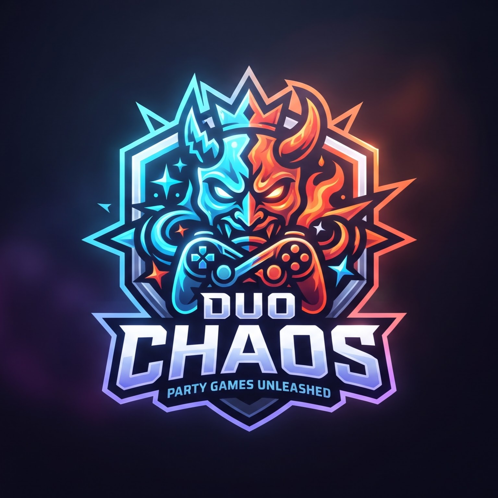

<div align="center">

  
  
  # 🎮 DUO CHAOS
  <h3>Party Games Unleashed! Platform Mabar Web Interaktif Generasi Masa Kini</h3>

  <p>
    <em>Bikin suasana nongkrongan dan mabar virtual makin seru tanpa perlu download aplikasi. Cukup buat room, undang teman, dan hancurkan persahabatan kalian! 😈</em>
  </p>

  <!-- Badges -->
  <p>
    <a href="https://github.com/USERNAME_KAMU/duo-chaos/blob/main/LICENSE"></a>
    <a href="https://github.com/USERNAME_KAMU/duo-chaos/stargazers"></a>
    <a href="https://github.com/USERNAME_KAMU/duo-chaos/network/members"></a>
    <a href="https://github.com/USERNAME_KAMU/duo-chaos/issues"></a>
    <a href="https://duo-chaos.vercel.app"></a>
  </p>

  <!-- Tech Stack Badges -->
  <p>
    
    
    
    
    
  </p>

</div>

---

## 💎 Tentang DUO CHAOS

> **DUO CHAOS** adalah platform web *party game* multiplayer real-time bergaya modern dengan estetika visual yang mewah dan imersif. Dirancang khusus untuk mencairkan suasana—baik saat nongkrong bareng di kafe maupun mabar jarak jauh secara virtual. 

Tanpa instalasi ribet, tanpa repot *download* aplikasi tambahan. Cukup buka *browser*, buat *room*, bagikan tautan unik ke teman-temanmu, dan nikmati pengalaman bermain game kompetitif yang seru dan penuh kekacauan menyenangkan!

---

## 🌟 Fitur Unggulan

- ⚡ **Real-Time Multiplayer** – Sinkronisasi aksi game berkecepatan tinggi tanpa *delay* berkat teknologi WebSockets dari Supabase Realtime.
- 🎨 **Custom Avatar & Profiles** – Personalisasi karakter kocak dan profil unikmu sebelum memasuki medan pertempuran.
- 🎭 **Live Emote Overlay** – Ekspresikan emosi secara instan dengan spam reaksi emoji dan stiker langsung di atas layar permainan.
- 👁️ **Spectator Mode** – Ruangan sudah penuh? Teman tetap bisa bergabung sebagai penonton (*spectator*) untuk meramaikan suasana dan memberikan dukungan.
- 🔄 **Rematch & Voting System** – Fitur tanding ulang instan dengan sistem voting otomatis setelah sesi game berakhir.
- 🛠️ **Maintenance Mode with Minigames** – Halaman pemeliharaan sistem yang elegan, dilengkapi hitung mundur otomatis dan *mini-game* tersembunyi (*Chaos Catcher*) agar pemain tidak bosan.

---

## 🎮 Koleksi Mini-Game

<details>
  <summary><b>Klik untuk melihat daftar lengkap mini-game yang tersedia 👇</b></summary>
  <br>

  | Game | Deskripsi | Vibe / Suasana |
  | :--- | :--- | :--- |
  | ⚔️ **Truth or Dare** | Klasik, brutal, dan tanpa ampun. Pilih jujur atau lakukan tantangan konyol. | 🌶️ Pedas & Seru |
  | 🧠 **Mind Reader** | Uji seberapa sehati kamu dengan temanmu. Jawab pertanyaan yang sama persis! | 🤝 Kompak |
  | ⚡ **Speed Battle** | Adu kecepatan refleks jemari. Siapa cepat dia panen poin kemenangan. | 🏃‍♂️ Tegang & Kompetitif |
  | 🗳️ **Most Likely To** | *Vote* siapa di antara kalian yang paling mungkin melakukan hal paling memalukan. | 🤡 Lucu & Kocak |
  | 🕵️ **Detektif Impostor** | Cari tahu siapa penyusup di antara kalian yang tidak tahu kata rahasianya. | 🔪 Penuh Tipu Muslihat |
  | 🎨 **Tebak Gambar (Doodle)** | Gambar seadanya, tebak seenaknya dengan kreativitas tanpa batas. | 🎨 Kreatif |

</details>

---

## 💻 Tech Stack & Arsitektur

Project ini dibangun menggunakan teknologi web modern berkinerja tinggi:

- **Framework:** [Next.js](https://nextjs.org/) (App Router & Server Components)
- **Database & Auth:** [Supabase](https://supabase.com/) (PostgreSQL, Row Level Security, & Realtime WebSockets)
- **Styling:** [Tailwind CSS](https://tailwindcss.com/) untuk desain responsif dan elegan
- **Animation:** [Framer Motion](https://www.framer.com/motion/) untuk transisi UI yang mulus
- **Icons:** [Lucide React](https://lucide.dev/)
- **Deployment:** [Vercel](https://vercel.com/)

---

## 🛠️ Instalasi & Menjalankan di Lokal

Ingin mencoba menjalankan atau memodifikasi **DUO CHAOS** di komputer lokalmu? Ikuti langkah-langkah di bawah ini:

### Prasyarat
Pastikan komputer kamu sudah menginstal:
- [Node.js](https://nodejs.org/) (Versi 18 atau terbaru disarankan)
- Git

### 1. Clone Repository
```bash
git clone [https://github.com/USERNAME_KAMU/duo-chaos.git](https://github.com/USERNAME_KAMU/duo-chaos.git)
cd duo-chaos
